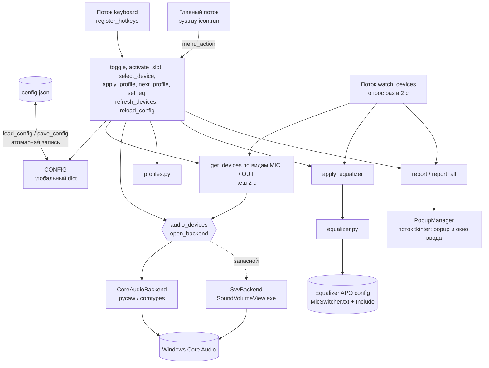

# Архитектура

## Общая схема



Приложение (`mic_switcher_tray.py`) не знает, как устроены звук и эквалайзер: устройства - через `audio_devices`, профили - чистые функции `profiles.py`, файлы Equalizer APO - `equalizer.py`.

## Пакет `audio_devices`

### Общий интерфейс (`__init__.py`)

- `Device(id, name, interface, flow)` - неизменяемое описание устройства. `label` - подпись для меню («Микрофон — Realtek(R) Audio»), `legacy_id` - ID в формате SoundVolumeView для миграции старых конфигов.
- `CAPTURE` / `RENDER` - направление, `ROLE_CONSOLE` / `ROLE_MULTIMEDIA` / `ROLE_COMMUNICATIONS` - роли Windows.
- `parse_roles(set_default_mode)`: `0`/`console`, `1`/`multimedia`, `2`/`communications`, `all`; неизвестное значение = все роли.
- Реализация обязана уметь: `list_devices(flow)`, `get_default_id(flow, role)`, `set_default(device_id, roles)`; атрибуты `name` и `watchable` (дешёвый ли опрос для автообновления).

### Выбор реализации (`open_backend`)

| `audio_backend` | Поведение |
|---|---|
| `auto` (по умолчанию) | Core Audio; если он не создался (нет pycaw, сломан `IPolicyConfig`) и `SoundVolumeView.exe` лежит по `sound_volume_view_path` - SoundVolumeView с предупреждением в стартовом popup |
| `core` | Только Core Audio, ошибка - окно ошибки и выход |
| `svv` | Только SoundVolumeView |

### Core Audio (`core.py`)

- Перечисление: `IMMDeviceEnumerator.EnumAudioEndpoints(flow, DEVICE_STATE_ACTIVE)`. Имя - `PKEY_Device_DeviceDesc` («Микрофон»), запасное - `PKEY_Device_FriendlyName`, интерфейс - `PKEY_DeviceInterface_FriendlyName` («Realtek(R) Audio»). Каждый `PROPVARIANT` освобождается (`clear`).
- Текущий: `GetDefaultAudioEndpoint(flow, role)`; нет устройств (`E_NOTFOUND`) - `None`.
- Переключение: `IPolicyConfig.SetDefaultEndpoint(id, role)` для каждой роли. Интерфейс недокументирован, его же используют SoundVolumeView, NirCmd, AudioDeviceCmdlets.
- Проверка при создании: конструктор сразу создаёт перечислитель и `IPolicyConfig`, чтобы `auto` успел уйти на запасной вариант.
- COM и потоки: `CoInitialize` один раз в каждом потоке при первом вызове (`threading.local`), конфликт режима COM игнорируется. COM-объекты между потоками не передаются: перечислитель и `IPolicyConfig` создаются на каждый вызов, это дешёвые in-process объекты.

### SoundVolumeView (`svv.py`)

- Список: `SoundVolumeView.exe /scomma <tmp.csv> /Columns ...` во временный файл, `csv.DictReader`, фильтр по `Direction`/`Type`/`Device State`. ID - колонка `Command-Line Friendly ID`, интерфейс - её первая часть до `\`.
- Текущий: колонка `Default` / `Default Multimedia` / `Default Communications` по роли.
- Переключение: `/SetDefault <id> all` для всех ролей сразу или по одному вызову на роль.
- `watchable = False`: каждый вызов - процесс, автообновление с ним не запускается.

## Приложение

### Виды устройств

`Kind` описывает вид: `MIC` (запись, `CAPTURE`, слоты `Mic 1/2`, хоткей `hotkey`) и `OUT` (воспроизведение, `RENDER`, слоты `Out 1/2`, хоткей `hotkey_out`). Все функции слотов, переключения, кеша и автообновления принимают `kind`; ключи конфига - `selected_<kind.key>_<N>` и `eq_<kind.key>`. Новый вид устройств = новый `Kind` в `KINDS`.

### Запуск (`main`)

1. `load_config()` + `apply_config()`. Импорт модулей побочных эффектов не имеет.
2. `open_audio()`: реализация звука. Не открылась - `MessageBoxW` с инструкцией, выход с кодом 1.
3. `ensure_all_selections()`: миграция старых ID и автовыбор слотов для каждого вида.
4. `register_hotkeys()`, `apply_equalizer()`.
5. Иконка трея, стартовый popup (`report_all`), `start_watcher()`, `icon.run()`.

### Потоки и блокировки

| Поток | Что делает |
|---|---|
| Главный | Цикл pystray, все обработчики меню |
| Поток `keyboard` (создаёт сама библиотека) | Хоткеи: `toggle(kind)`, `next_profile`, `apply_profile(name)` |
| `watch_devices` (daemon) | Раз в 2 с: списки обоих видов и текущие устройства |
| `PopupManager._run` (daemon) | `tk.Tk()`, popup-ы, окно ввода, панель настроек и `call(fn)` из очереди |
| Короткие потоки панели | `panel_state()` и действия панели |
| Короткий поток на ответ окна ввода | `save_profile_named(name)` |

| Блокировка | Защищает |
|---|---|
| `switch_lock` | Переключение и применение профиля. `toggle` берёт без ожидания, `activate_slot` и `apply_profile` ждут |
| `config_lock` | Запись `config.json` |
| `cache_lock` | Кеш устройств (по `flow`) |
| `log_lock` | Ротация и запись лога |

### Слоты и переключение

- `get_devices(kind, force=False)`: `backend.list_devices(kind.flow)` с кешем на 2 с; опрос и «Обновить список» - `force=True`.
- `get_current_id(kind)`: `backend.get_default_id(kind.flow, ROLES[0])`.
- `toggle(kind)`: `TOGGLE_COOLDOWN` 0.3 с отдельно для каждого вида, `pick_toggle_target` (текущий = слот 1 ? слот 2 : слот 1), `set_default_device`, затем `switched(...)` = сообщение + `apply_equalizer()` (эквалайзер переезжает на новое устройство).
- `migrate_legacy_selection` / `ensure_default_selection(kind)` / `select_device(kind, slot, id)` - как раньше для микрофона, теперь для каждого вида.

### Профили (`profiles.py` + приложение)

- `Profile(name, mic, out, eq_mic, eq_out, hotkey)`; `eq_* = None` - пресет не трогать, пустой `mic`/`out` - устройство не трогать.
- `profiles.load` пропускает битые записи и повторы имён (без учёта регистра), `next_after` - по кругу, `upsert` заменяет по имени, `remove`, `auto_name`.
- `apply_profile(name)` под `switch_lock`: вывод, затем микрофон (отключённое - строка «... не подключен»), пресеты, `active_profile`, `apply_equalizer()`, один popup.
- `save_current_profile()` подставляет имя «<вывод> + <микрофон>» и открывает `popups.ask`; ответ - `save_profile_named`: текущие устройства и пресеты, хоткей существующего профиля сохраняется, `register_hotkeys()`.

### Эквалайзер (`equalizer.py` + приложение)

- `find_config_dir`: `equalizer_apo_config_dir` из конфига, иначе `HKLM\SOFTWARE\EqualizerAPO\ConfigPath`, иначе `%ProgramFiles%\EqualizerAPO\config`. Нет папки - Equalizer APO не установлен.
- `presets(target, custom)`: встроенные `BUILTIN_PRESETS` + свои из `eq_custom_presets` с нужным `target`.
- `apply_equalizer()`: для каждого вида с пресетом не `off` - текущее устройство, `resolve_commands` (подстановка пути RNNoise), `device_pattern` (GUID из ID Core Audio без скобок, иначе имя), `render` в текст:

  ```text
  # MicSwitcher: файл пересоздаётся автоматически, ручные правки пропадут.

  # Вывод: Наушники — Jabra, пресет «Бас»
  Device: 11111111-2222-3333-4444-555555555555
  Preamp: -6 dB
  Filter: ON LSC Fc 105 Hz Gain 6 dB Q 0.7

  Device: all
  ```

- `Device:` в Equalizer APO: каждое слово шаблона ищется как подстрока в имени, подключении и GUID устройства, должны найтись все. Поэтому GUID без скобок.
- Шумодав: пресеты с `VSTPlugin: Library "{rnnoise}"`. `find_rnnoise` ищет `rnnoise_stereo.dll` / `rnnoise_mono.dll` в `<Equalizer APO>\VSTPlugins` (папка рядом с `config`, глубина до 4, стерео и x64 в приоритете) или берёт `rnnoise_vst_path`. Equalizer APO разбирает строку как пары «ключ значение» с кавычками, `Library` - путь к VST2-плагину, остальные ключи - параметры плагина; Плагин собран на JUCE и в VST2 работает в режиме chunk (`effFlagsProgramChunks`): Equalizer APO передаёт ему только `ChunkData`, пары «имя значение» игнорируются. Поэтому порог (`rnnoise_vad_threshold`, 0..100 или `null`) передаётся через `rnnoise_chunk`: Base64 от `copyXmlToBinary` JUCE (`<II` магическое число `0x21324356` и длина XML, XML `<RNNoise><PARAM id="vad_threshold" value="0.9"/>...</RNNoise>`, нулевой байт). JUCE на `effSetChunk` вызывает `setStateInformation`, RNNoise проверяет тег `RNNoise` и применяет значения. `null` - `ChunkData` не пишется, у плагина его 60%. Плагина нет - секция пропускается с предупреждением, остальное применяется.
- `install`: `ensure_include` дописывает `Include: MicSwitcher.txt` в `config.txt`, если строки нет; `write_settings` пишет `MicSwitcher.txt` через временный файл. Equalizer APO перечитывает файлы сам.
- Все пресеты `off` и файла ещё нет - ничего не пишется. Equalizer APO не найден при выставленном пресете - предупреждение.
- Когда вызывается: выбор пресета, переключение слота, профиль, старт, перечитывание конфига и смена устройства по умолчанию вне MicSwitcher (замечает `watch_devices`).

### Автоустановка (`installer.py` + приложение)

- Версии и SHA-256 закреплены: RNNoise `v1.10` (`win-rnnoise.zip`, из архива берутся только `vst/rnnoise_stereo.dll` и `vst/rnnoise_mono.dll`, одноимённые dll из `.lv2` - другой формат), Equalizer APO `1.4.2` (`EqualizerAPO-x64-1.4.2.exe`, SHA-1 сверен с SourceForge). Несовпадение хэша - файл удаляется, `InstallError`.
- `install_rnnoise(app_dir, config_dir)`: источник - `<папка приложения>\plugins\rnnoise` (кладёт CI в zip релиза), иначе скачивание. Цель - `<Equalizer APO>\VSTPlugins\RNNoise`. `PermissionError` при копировании - `elevated_copy`: обычный PowerShell запускает PowerShell с `-Verb RunAs -Wait` (окно UAC), скрипт передаётся `-EncodedCommand`; успех проверяется наличием файлов.
- Приложение: `set_eq` для микрофона с пресетом RNNoise без плагина запускает `install_noise_suppression` в фоне и сам не показывает popup; итог - «Шумодав установлен.» или ошибка. `install_equalizer_apo` скачивает и запускает установщик (`os.startfile`), дальше Configurator и перезагрузка - за пользователем. Обе под `install_lock`: вторая установка параллельно не начнётся.
- `find_rnnoise` пропускает пути с `.lv2` и `ladspa`.

### Панель настроек (`panel.py` + приложение)

- `Panel` - `tk.Toplevel` в потоке `PopupManager` (`popups.root`), одна на приложение: `open_panel()` через `popups.call` создаёт её или поднимает существующую. Пункт меню «Панель настроек...» - `default=True`, открывается кликом по иконке.
- Панель не знает про звук: `actions.state()` = `panel_state()` - словарь-снимок (устройства, слоты, текущие, профили, эквалайзер, пороги, хоткеи, автозапуск); `panel_actions()` - `SimpleNamespace` с функциями приложения, виды передаются ключами `"mic"`/`"out"`.
- Снимок собирается в фоновом потоке (там вызовы звука), отрисовка - `call_ui` в потоке tkinter. Действия (`Panel.do`) - тоже в фоне, после них `request_refresh()`. Плюс автообновление раз в 3 с (10 с для медленной реализации) и `refresh_panel()` из `refresh_menu()`.
- Поля ввода не перетираются, пока в них фокус; поля хоткеев перерисовываются только когда хоткеи в конфиге изменились.
- `Choice` - Combobox «подпись - значение»; выбор пользователя (`<<ComboboxSelected>>`) вызывает действие, программная установка - нет.
- Новые функции приложения для панели: `set_hotkeys(values)`, `set_profile_hotkey(name, combo)`, `set_auto_refresh(enabled)`, `record_hotkey()` (`keyboard.read_hotkey` в фоне).

### Хоткеи

`hotkey_bindings()` собирает `(сочетание, функция, аргументы, описание)`: `hotkey`, `hotkey_out`, `hotkey_profile`, `hotkey` каждого профиля; пустые пропускаются. `register_hotkeys()` снимает все прежние (`hotkey_handles`) и регистрирует заново, ошибки возвращает списком для popup. Вызывается при старте, перечитывании конфига, сохранении и удалении профиля.

### Автообновление (`watch_devices`)

Опрос, а не COM-события. По каждому виду `diff_devices(kind, previous, current)` даёт строки «Подключен микрофон: ...» / «Отключен вывод: ...» - меню обновляется, popup. Отдельно сравниваются текущие устройства по умолчанию: изменились - `apply_equalizer()` без popup (кроме ошибки). Выбор слотов не меняется. Запускается только при `auto_refresh` и `backend.watchable`.

### Меню

`build_menu()` строит меню целиком: переключатели видов с хоткеями, «Профиль», подменю видов (`build_kind_menu`), «Эквалайзер» (`build_eq_menu`), остальное. Обработчики - `menu_action(fn, *args)`, отметки radio - `make_checked(getter, value)`. Подписи статичны до `refresh_menu()`.

### Конфиг

- `DEFAULT_CONFIG` копируется через `deepcopy`: списки и словари по умолчанию не общие между загрузками.
- Битый JSON - `config.json.broken`; запись атомарная; лишние ключи сохраняются.
- `reload_config`: конфиг, хоткеи, реализация звука, автовыбор, эквалайзер, опрос, меню; итог - один popup.

### Автозапуск и обратная связь

- `HKCU\Software\Microsoft\Windows\CurrentVersion\Run\MicSwitcher`; из исходников через `pythonw.exe`; включён, только если значение совпадает с `get_autorun_command()`.
- `report` - подсказка иконки (до 127 символов), лог, popup; `report_all` - несколько сообщений одним popup.

## Файлы приложения

| Файл | Где | Когда |
|---|---|---|
| `config.json` | Папка приложения | Создаётся при первом запуске, переписывается при выборе слотов, профилей, пресетов |
| `config.json.broken` | Там же | Копия повреждённого конфига |
| `mic_switcher.log`, `.log.1` | По `log_file` | Дописывается всегда, ротация на 1 МБ |
| `MicSwitcher.txt` | Папка `config` Equalizer APO | Пересоздаётся при каждом применении эквалайзера |
| строка в `config.txt` | Там же | `Include: MicSwitcher.txt`, один раз |
| `mic_switcher_*.csv` | `%TEMP%` | Только с SoundVolumeView, на время одного экспорта |
